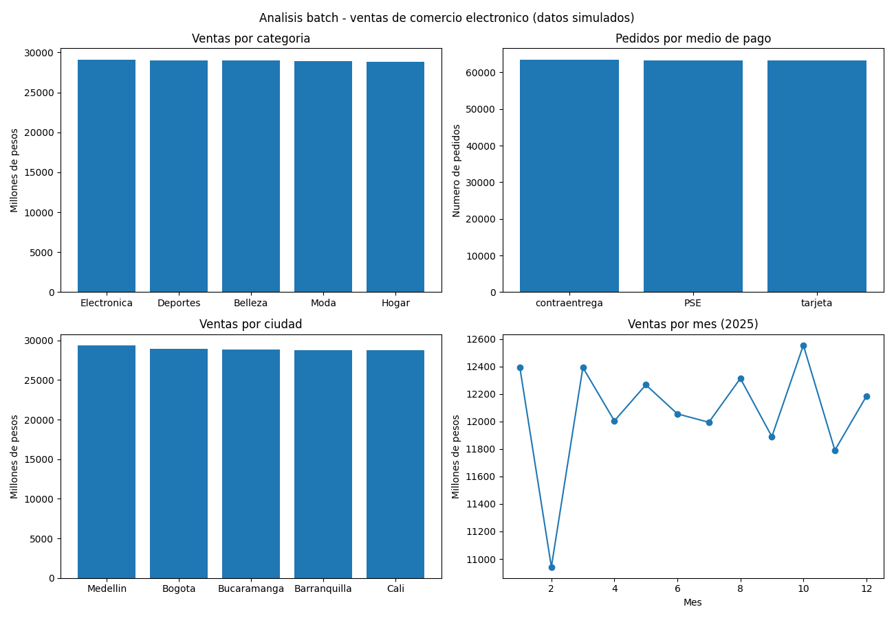

# Procesamiento en batch con Apache Spark: ventas de comercio electrónico (datos simulados)

Repositorio de la Tarea 3 del curso Big Data (código 202016911_73), Universidad Nacional Abierta y a Distancia (UNAD).

**Autor:** Néstor Mauricio Chaparro Acero

**Presentado a:** Ing. Nevardo Alonso Ayala Rojas

## Descripción de la solución

Este proyecto procesa en batch un conjunto de datos de pedidos de una tienda en línea. Usa Apache Spark (PySpark) sobre una máquina virtual Ubuntu con Hadoop. El flujo completo es:

1. **Carga:** se lee el CSV desde HDFS.
2. **Limpieza:** se eliminan los registros duplicados, los que no tienen categoría o fecha y los que tienen cantidades no positivas.
3. **Transformación:** se convierte la fecha y se crean las columnas `total` (cantidad por precio unitario) y `mes`.
4. **Análisis exploratorio (EDA):** estadísticas básicas y agregaciones por categoría, medio de pago, ciudad y mes.
5. **Visualización:** una imagen con cuatro gráficos de los resultados.

## Conjunto de datos

Los datos son **simulados**. No provienen de una tienda real. Los genera el script `generar_dataset.py` con valores aleatorios y una semilla fija (`seed 42`), por lo que el archivo se puede reproducir.

- **Columnas:** `order_id`, `customer_id`, `category`, `quantity`, `unit_price`, `payment_method`, `city`, `order_date`.
- **Registros:** 200.000 pedidos únicos, más 1.978 filas duplicadas introducidas a propósito (201.978 filas en total).
- **Tamaño en HDFS:** 12,8 MB.
- **Errores introducidos a propósito**, para demostrar la etapa de limpieza: cerca del 2 % de pedidos sin categoría, 2 % con cantidad negativa, 1 % sin fecha y 1 % de filas duplicadas.

## Contenido del repositorio

| Archivo | Descripción |
|---|---|
| `generar_dataset.py` | Genera el CSV simulado `ventas_ecommerce.csv`. |
| `procesamiento_batch.py` | Carga, limpia, transforma y analiza los datos, y guarda el gráfico. |
| `grafico_batch.png` | Gráficos resultantes de la ejecución. |
| `README.md` | Este documento. |

## Entorno

- Máquina virtual Ubuntu con Hadoop (HDFS y YARN) y Apache Spark, instalada según los instructivos del curso (Anexos 1 y 2).
- Python 3, PySpark y matplotlib 3.10.9.
- Dos usuarios en la VM: `hadoop` (servicios de Hadoop) y `vboxuser` (ejecución de los scripts).

## Instrucciones de ejecución

**1. Iniciar Hadoop** (sesión del usuario `hadoop`) y comprobar los servicios:

```bash
start-all.sh
jps
```

`jps` debe mostrar `NameNode`, `DataNode`, `SecondaryNameNode`, `ResourceManager` y `NodeManager`.

**2. Instalar las librerías de Python** (sesión de `vboxuser`, solo la primera vez):

```bash
sudo pip install pyspark==3.5.1
python3 -m pip install matplotlib
```

La instalación de PySpark sigue el Anexo 2 del curso.

**3. Generar el CSV** (sesión de `vboxuser`):

```bash
python3 generar_dataset.py
cp ventas_ecommerce.csv /tmp/ventas_ecommerce.csv
chmod 644 /tmp/ventas_ecommerce.csv
```

La copia a `/tmp` permite que el usuario `hadoop` lea el archivo.

**4. Cargar el CSV en HDFS** (sesión del usuario `hadoop`):

```bash
hdfs dfs -mkdir /ecommerce
hdfs dfs -put /tmp/ventas_ecommerce.csv /ecommerce
hdfs dfs -ls -h /ecommerce
```

**5. Ejecutar el procesamiento** (sesión de `vboxuser`):

```bash
python3 procesamiento_batch.py
```

El script imprime en consola la carga, la limpieza, las estadísticas y las tablas del análisis. Al final guarda el gráfico en `/home/vboxuser/grafico_batch.png`. Esa ruta está escrita dentro del script: si se ejecuta con otro usuario, hay que cambiarla.

## Resultados obtenidos en la ejecución

**Limpieza:**

| Paso | Registros eliminados |
|---|---|
| Duplicados | 1.978 |
| Sin categoría o sin fecha | 6.089 |
| Cantidad no positiva | 4.016 |
| **Registros finales** | **189.895** |

**Estadísticas básicas:** el valor medio por pedido (`total`) fue de unos 762.469 pesos, con un mínimo de 10.000 y un máximo de 2.500.000.

**Agregaciones:** las cinco categorías suman ventas muy parecidas, entre 28.800 y 29.100 millones de pesos. Los tres medios de pago tienen cerca de 63.000 pedidos cada uno.



## Limitaciones

- Los datos son simulados con distribución uniforme. Las diferencias entre categorías, ciudades o meses vienen del azar y **no representan un comportamiento real de ventas**. El proyecto demuestra el flujo de procesamiento, no hallazgos de negocio.
- El conjunto de datos es de tamaño moderado (12,8 MB). La solución está escrita con Spark y funcionaría con volúmenes mayores cambiando el valor `N` de `generar_dataset.py`, pero eso no se probó en este trabajo.
